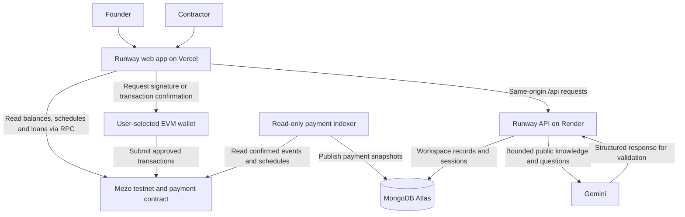
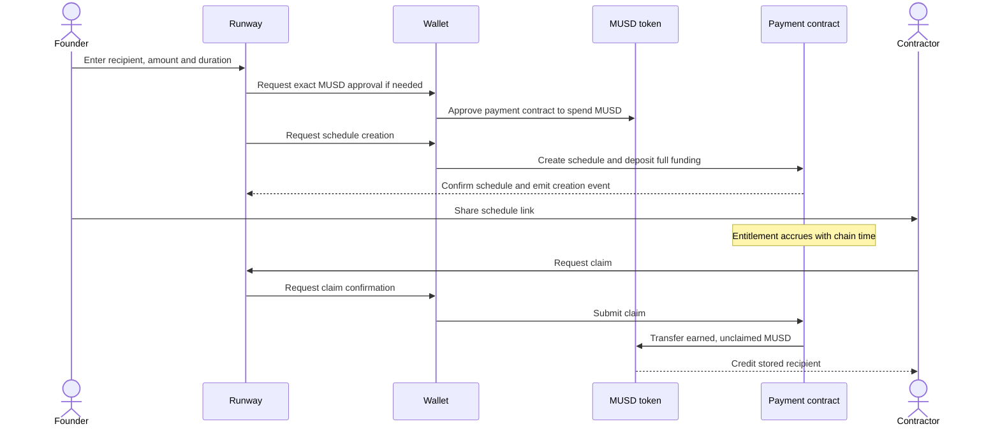
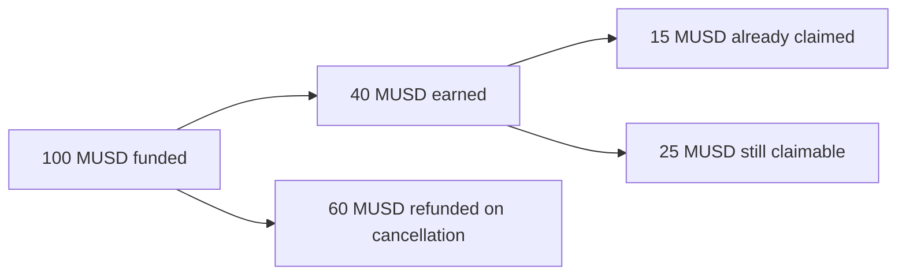
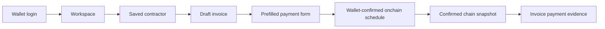

# How Mezo Runway works: high-level overview

This document explains the current application for founders, reviewers and new contributors. For implementation details, see the [low-level design](app-low-level.md). Describes the Wave 1 application released October 20, 2026; future features are identified separately.

**[Live application](https://mezo-runway-testnet.vercel.app) · [User guide](user-guide.md) · [Repository overview](../README.md)**

## 1. Purpose

Runway helps a founder commit MUSD to a contractor, let the contractor claim earned funds over time, and understand how long current funding can support payroll. It runs on **Mezo testnet**, where MUSD is the payment asset and BTC pays transaction gas.

The founder deposits the entire schedule amount into a smart contract. Entitlement grows linearly between the schedule's start and end. Funds move to the contractor when a claim transaction succeeds; accrual alone does not transfer tokens.

Three amounts have different meanings:

| Term             | Meaning                                                             |
| ---------------- | ------------------------------------------------------------------- |
| Funded           | MUSD deposited into the payment contract for a schedule.            |
| Earned or vested | The part of that allocation the recipient has earned by chain time. |
| Claimed or paid  | MUSD actually transferred to the stored recipient.                  |

## 2. System overview

The indexer runs inside the hosted API process. It is drawn separately because its job differs from serving requests.

The wallet authorizes financial transactions. The backend stores workspace records and builds payment evidence from the chain. The Assistant explains reviewed documentation and cannot operate the wallet.

## 3. Main user journeys

### Fund and claim a payment

The approval is a token transaction, and schedule creation is a separate contract transaction. The app checks existing allowance first, so an approval prompt is only needed when allowance is insufficient.

Anyone can call the contract's claim function, but payment always goes to the recipient saved at creation. The founder cannot change that recipient after funding.

### Cancel before the end

Only the sender can cancel a schedule, and only before it ends. Cancellation freezes earned entitlement, returns the unvested portion to the sender, and leaves earned but unclaimed MUSD available to the recipient.

For a simplified example, suppose 100 MUSD is funded over ten days. After exactly four days, 40 MUSD is earned. If the recipient already claimed 15 MUSD, cancellation returns 60 MUSD to the sender and leaves another 25 MUSD claimable. The recipient keeps the 15 MUSD already paid.

Actual calculations use integer token units and chain timestamps.

### Organize invoices in Workspace

A founder signs a wallet login message to access private workspaces. This signature proves control of an address; it does not approve a payment.

The founder saves contractors, creates draft invoices and opens a funding form with the recipient, amount and an opaque payment reference already supplied. The indexer later observes confirmed schedules and claims. The API matches them to the invoice and reports payment evidence.

An invoice remains a business record. Its derived payment status can be funded, partially claimed, paid or cancelled. If indexing is behind or unavailable, Runway reports that rather than treating an old snapshot as current proof.

### Plan payroll and inspect borrowing

The Overview shows a compact payment-only summary. The Borrowing page includes the full planner and a read-only Mezo loan viewer.

The planner first identifies the connected wallet's currently active outgoing schedules. Existing escrow covers each stream until its own end; hypothetical wallet spending to renew that stream starts at that end. This avoids counting the same escrow as spendable wallet cash.

A separate estimate considers additional borrowing capacity under a hypothetical BTC price drop and a chosen collateral ratio. It is not added to the continuous payroll coverage date. Planning months contain 30 days. Fees, future interest and other protocol constraints limit the estimate.

The loan viewer reads collateral, interest-inclusive debt and protocol price information. It can inspect a supplied public address, but the planner still uses the connected wallet. Runway opens Mezo for borrowing and repayment; it does not submit those transactions.

### Ask Runway

A visitor can ask questions without connecting a wallet. The server classifies the question, selects reviewed public knowledge, asks Gemini for a structured answer, validates the cited sources and returns the answer with approved links.

It has no live wallet, database-query, browsing or transaction tools. Planner-specific knowledge still requires a separate backend update; new frontend documentation does not automatically update the deployed Assistant.

## 4. Pages and access

| Page                        | Purpose                                                        | Access                                                    |
| --------------------------- | -------------------------------------------------------------- | --------------------------------------------------------- |
| Overview, `/`               | Balances, discovered schedules and compact payroll summary.    | Connect a wallet for account-specific reads.              |
| New schedule, `/?create=1`  | Enter payment terms and fund a schedule.                       | Wallet on Mezo testnet for transactions.                  |
| Schedule, `/schedules/<id>` | Inspect one public schedule, claim, cancel and view history.   | Reads need no wallet; actions require a wallet.           |
| Workspace, `/workspace`     | Contractors, invoices and payment evidence.                    | Connected wallet and authenticated owner session.         |
| Borrowing, `/borrowing`     | Public loan reads, price stress and connected-wallet planning. | Public-address loan lookup; wallet for personal planning. |
| Assistant, `/assistant`     | Documentation-based questions and answers.                     | No wallet login; backend usage limits apply.              |
| Documentation, `/docs`      | Guide, manual setup and Markdown download.                     | No wallet or API login.                                   |

## 5. Where information lives

| Location                | Information                                                                                             | Authority and visibility                                              |
| ----------------------- | ------------------------------------------------------------------------------------------------------- | --------------------------------------------------------------------- |
| Mezo blockchain         | Schedules, token balances, claims, cancellations and loan state.                                        | Public financial state.                                               |
| MongoDB                 | Workspace records, contractors, invoices, hashed sessions, rate counters and indexed payment snapshots. | Owner-authorized business records; indexed state is derived evidence. |
| Browser storage         | Pending-transaction tracking scoped to chain and contract.                                              | Local recovery aid; not proof of settlement.                          |
| Reviewed knowledge file | Product explanations and registered sources.                                                            | Public reference content, not live chain data.                        |
| User wallet             | Account authorization and signing.                                                                      | Runway does not request private keys or seed phrases.                 |

## 6. Availability and trust

Chain reads and payment transactions do not need the workspace database, but they do need working RPC and wallet infrastructure. Workspace, Assistant and reconciliation depend on Render and MongoDB. Free Render hosting can sleep, pausing the embedded indexer. The app shows bounded wake-up progress and retry controls; a healthy API does not guarantee that indexing has caught up.

The payment contract has no owner, upgrade path or arbitrary withdrawal function. The external MUSD token has separate privileged roles that can affect escrow balances. Explorer verification establishes source correspondence; it is not a security audit. Read the [security policy](../SECURITY.md) for assumptions and reporting.

## 7. Current delivery boundary

Payments, wallet setup, workspace, reconciliation, documentation-based Assistant, read-only borrowing and the planner are implemented. Real installed-wallet setup/login validation, demo/submission preparation and external organizer confirmations remain outstanding.

Direct borrowing/repayment in Runway, Assistant live-data tools and confirmed action preparation, Mezo Passport and team/payroll automation remain future work. No mainnet release is supported.

For the source-level mechanics, continue with the [low-level design](app-low-level.md).
