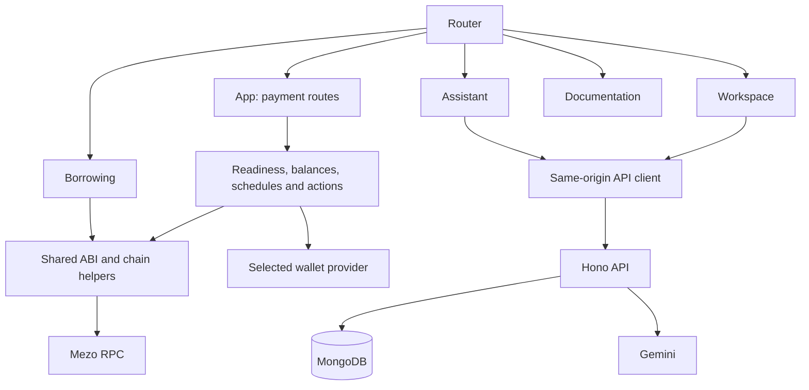
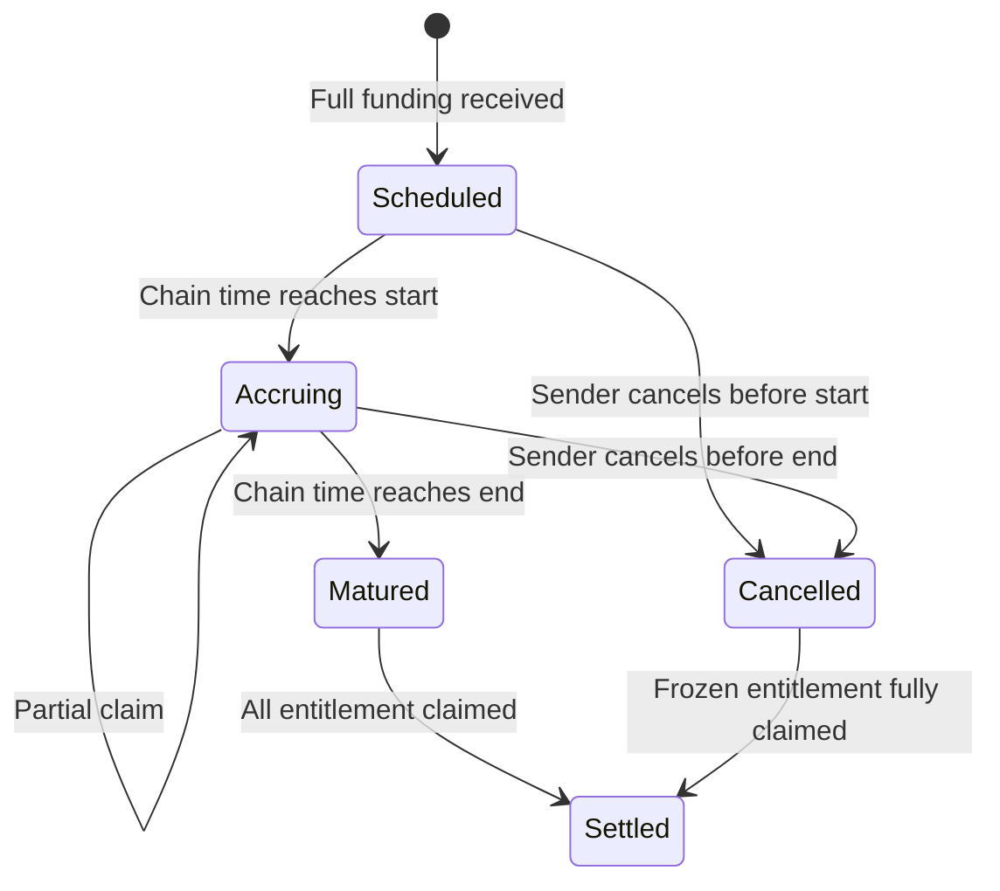
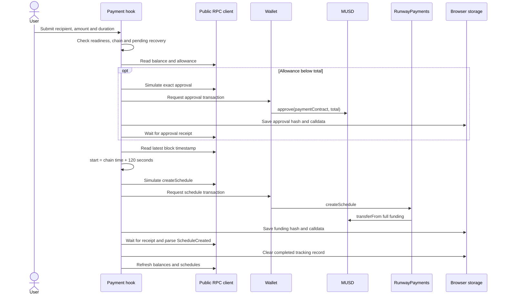
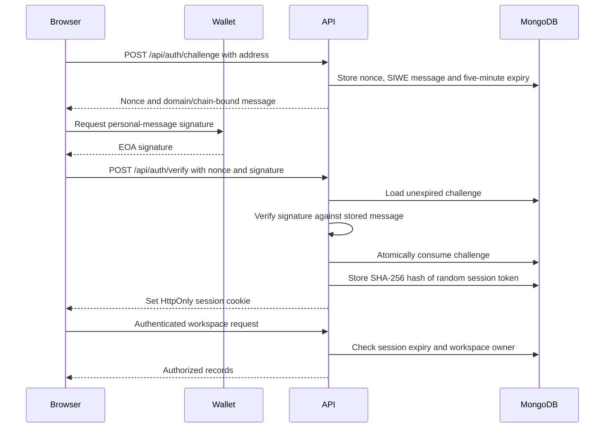
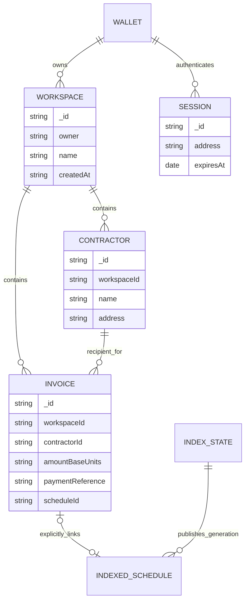
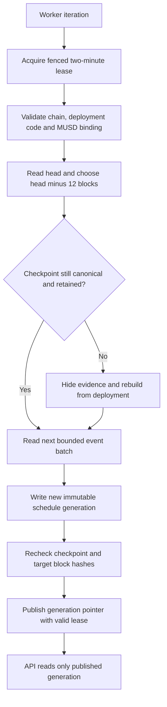
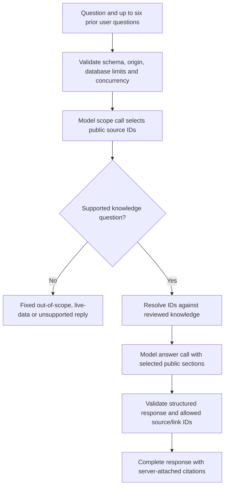
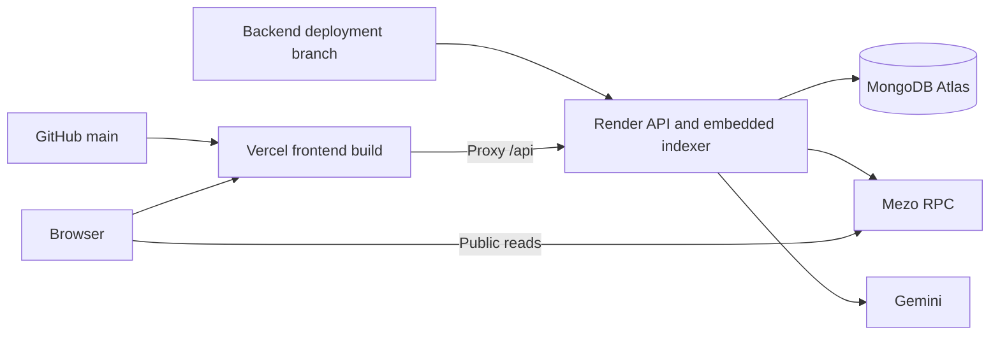

# How Mezo Runway works: low-level design

This document describes the implementation behind the [high-level overview](app-high-level.md). It covers the current Wave 1 code, with release context from October 20, 2026. It does not claim that the live services have been reverified today.

## 1. Code and runtime boundaries

| Area                  | Entry points and responsibilities                                                                                                                                                                              |
| --------------------- | -------------------------------------------------------------------------------------------------------------------------------------------------------------------------------------------------------------- |
| Browser boot          | [main.tsx](../apps/web/src/main.tsx) installs wagmi and TanStack Query providers, then mounts the router.                                                                                                      |
| Routing               | [Router.tsx](../apps/web/src/Router.tsx) intercepts supported same-origin links, uses browser history and lazy-loads secondary pages.                                                                          |
| Payment orchestration | [App.tsx](../apps/web/src/App.tsx) composes readiness, balances, schedules, actions and pending recovery.                                                                                                      |
| Payment hooks         | [usePaymentActions.ts](../apps/web/src/hooks/usePaymentActions.ts), [useSchedules.ts](../apps/web/src/hooks/useSchedules.ts) and [useDeploymentReadiness.ts](../apps/web/src/hooks/useDeploymentReadiness.ts). |
| Shared chain logic    | [Mezo package](../packages/mezo/src/index.ts), [borrowing reader](../packages/mezo/src/borrowing.ts) and [planner](../packages/mezo/src/planner.ts).                                                           |
| HTTP server           | [server.ts](../apps/api/src/server.ts) starts Hono and the optional embedded payment worker.                                                                                                                   |
| API and persistence   | [app.ts](../apps/api/src/app.ts) implements routes and authorization; [db.ts](../apps/api/src/db.ts) pools MongoDB connections and initializes indexes.                                                        |
| Indexed evidence      | [reconciliation.ts](../apps/api/src/reconciliation.ts) validates chain identity, publishes snapshots and derives invoice payment status.                                                                       |
| Assistant             | [assistant.ts](../apps/api/src/assistant.ts) validates model results; [assistant-knowledge.ts](../apps/api/src/assistant-knowledge.ts) loads reviewed public content.                                          |
| Settlement            | [RunwayPayments.sol](../contracts/src/RunwayPayments.sol) holds MUSD and enforces creation, claims and cancellation.                                                                                           |



The application uses a small custom router rather than a routing framework. Overview and creation share `App`; `?create=1` selects creation initially. Schedule IDs are positive integers parsed from `/schedules/<id>`. Workspace, Borrowing, Assistant and Documentation use React lazy imports with a Suspense fallback.

## 2. Configuration and deployment checks

Public configuration is read from the root environment through Vite. Only public values belong in `VITE_*`; database and model credentials remain in the API process.

| Setting                                               | Role                                                             |
| ----------------------------------------------------- | ---------------------------------------------------------------- |
| `VITE_MEZO_TESTNET_RPC`, `VITE_MEZO_TESTNET_CHAIN_ID` | Browser RPC and network configuration; supported chain is 31611. |
| `VITE_MUSD_ADDRESS`, `VITE_PAYMENT_CONTRACT_ADDRESS`  | Token and payment contract bindings.                             |
| `VITE_MEZO_TOKEN_ADDRESS`                             | Optional MEZO display, validated independently.                  |
| `MONGODB_URI`, `MONGODB_DATABASE`                     | Server database connection.                                      |
| `APP_ORIGIN`                                          | Exact allowed frontend origin for API mutations.                 |
| `GEMINI_API_KEY`, `GEMINI_MODEL`                      | Server-only Assistant provider configuration.                    |
| `PAYMENT_INDEXER_ENABLED`, `INDEXER_RPC_URL`          | Embedded indexer opt-in and server RPC override.                 |

Browser payment readiness checks RPC chain ID, MUSD code and symbol, token decimals, payment code and the payment contract's immutable `musd()` binding. These runtime checks are narrower than full bytecode verification. The indexer separately compares deployed payment bytecode with the recorded deployment identity.

A failure in optional MEZO validation does not block MUSD payments. BTC remains the gas currency.

## 3. Payment contract and exact accounting

Each schedule stores:

```text
sender, recipient, total, start, end, claimed,
cancelled, vestedAtCancellation, referenceHash
```

Token amounts are unsigned integer base units; MUSD uses 18 decimals. Contract time uses `block.timestamp`, not the browser clock.

For total allocation T, start s, end e and current chain time t:

```text
vested(t) = vestedAtCancellation                    if cancelled
          = 0                                       if t <= s
          = T                                       if t >= e
          = floor(T * (t - s) / (e - s))             otherwise

claimable = vested(t) - claimed
refund on cancellation = T - vested(t)
remaining obligation = (cancelled ? vestedAtCancellation : T) - claimed
```

Solidity uses full-precision `Math.mulDiv` for the intermediate vesting calculation. At the end, the full total vests despite earlier rounding.

| Operation        | Validation and effects                                                                                                                                                                                                                                  |
| ---------------- | ------------------------------------------------------------------------------------------------------------------------------------------------------------------------------------------------------------------------------------------------------- |
| `createSchedule` | Rejects zero/contract recipient, zero total, start in the past and end at/before start. Pulls the exact full amount with `SafeERC20`, checks the received balance delta, stores a new schedule, appends sender/recipient IDs and increases obligations. |
| `claim`          | Rejects unknown IDs and zero claimable amount. Updates claimed/obligations, then transfers to the stored recipient. Any caller is allowed.                                                                                                              |
| `cancel`         | Requires the original sender, an uncancelled schedule and time before end. Freezes vested entitlement, subtracts the refund from obligations and transfers that refund to the sender.                                                                   |

All three write entry points use `nonReentrant`. Claims and cancellation update accounting before outgoing transfers. Creation receives and validates MUSD before recording a schedule, under the reentrancy guard.



These are explanatory states, not an enum stored in Solidity. A cancellation with zero remaining entitlement can already be settled. A matured schedule with prior partial claims needs only its remaining amount claimed.

The expected escrow invariant is `MUSD balance >= outstandingObligations`, assuming external token balances/transfers behave as required. Donations create unrecoverable surplus. Privileged external MUSD burns can break the balance assumption; the payment contract cannot prevent token-level intervention.

## 4. Browser transaction pipeline



The hook validates nonzero recipient, decimal precision, positive funding, optional 32-byte reference and a duration of 1–525600 whole minutes. It uses bigint token units. Simulation can catch a revert before signing but cannot guarantee that state remains unchanged before mining.

If the two-minute start buffer expires while the user is signing, creation can revert. An earlier successful allowance may remain. A fresh attempt must use fresh chain time.

Claim and cancellation follow simulation, wallet submission, receipt tracking and refreshed reads. A submitted hash is not treated as confirmed payment.

### Pending recovery

[pending.ts](../apps/web/src/pending.ts) uses a versioned localStorage key scoped to chain and payment contract. The record includes sender, target, hash, calldata, action, optional schedule ID and submission time.

The app checks storage before signing, blocks new actions while unresolved tracking exists, and can resume receipt inspection after reload. The normal receipt wait is 120 seconds. Repriced replacements update the saved hash; other replacement reasons require review. Damaged storage produces an explicit recovery state.

Tracking begins after the wallet returns a hash. If storage fails after submission, the UI preserves the hash in memory and warns the user. Browser storage is a recovery aid, can be edited or cleared, and is not chain authority. See [PendingTransactionPanel.tsx](../apps/web/src/PendingTransactionPanel.tsx) for receipt and transaction inspection.

## 5. Schedule reads, history and freshness

[schedules.ts](../apps/web/src/schedules.ts) captures a source block/time and requests 20 sent IDs and 20 received IDs per page. Subsequent pages reuse that block through the cursor. It reads each schedule and claimable amount at the same block, deduplicates IDs and sorts them.

The React hook polls every 15 seconds, disables automatic query retries for this read and labels incomplete discovery. Sent obligations are summed only for the connected sender; until all pages are loaded, that sum is partial. An individual schedule link reads its ID directly without account discovery.

[history.ts](../apps/web/src/history.ts) scans creation, claim and cancellation logs from the configured deployment block. Each history page covers at most 10,000 blocks in 1,000-block RPC chunks. The UI discloses the scanned range and preserves prior pages when a later page fails. Receipts and CSV exports represent observed evidence, not a promise that every historical page has been loaded.

## 6. Wallet login and HTTP authorization

Wallet connection and server login are separate. Connecting exposes an account to the UI; Workspace additionally needs a verified server session.



Challenges expire after five minutes; sessions after one day. The random session token is 32 bytes, and MongoDB stores its SHA-256 digest. The cookie is `runway_session`, HttpOnly, SameSite=Strict, scoped to `/api`, and Secure when the configured origin is HTTPS.

TTL indexes clean expired records, but requests also check expiry directly. Disconnecting a wallet does not revoke the cookie; explicit workspace logout deletes the server session. Current login supports EOA signatures, not smart-contract wallet validation.

Global middleware adds security headers, disables response caching, caps bodies at 16 KiB and checks exact Origin on methods other than GET/HEAD. Origin checks supplement authorization; they do not prove a caller owns an account.

### HTTP interface

All paths below include the `/api` prefix.

| Method and path                                             | Access and result                                                              |
| ----------------------------------------------------------- | ------------------------------------------------------------------------------ |
| GET `/health`                                               | No login; database ping, 200 ready or 503 unavailable.                         |
| POST `/assistant/chat`                                      | No login; bounded question/history and model response.                         |
| POST `/auth/challenge`                                      | No login; creates an expiring wallet challenge.                                |
| POST `/auth/verify`                                         | No login; consumes a valid challenge and creates a session.                    |
| GET `/auth/session`                                         | Session required; returns authenticated address.                               |
| POST `/auth/logout`                                         | Session required; revokes it and clears the cookie.                            |
| GET/POST `/workspaces`                                      | Session required; list own workspaces or create one.                           |
| GET/POST `/workspaces/:workspaceId/contractors`             | Owner required; list/create saved contractors.                                 |
| GET/POST `/workspaces/:workspaceId/invoices`                | Owner required; list invoices with derived payment evidence or create a draft. |
| POST `/workspaces/:workspaceId/invoices/:invoiceId/payment` | Owner required; explicitly link a matching confirmed schedule.                 |

Lists return up to 25 items with `nextCursor`; `?after=<cursor>` requests another page. UUID IDs are validated. Mutation bodies are JSON. Typical failures include 400 invalid input, 401 missing/expired session, 403 wrong origin, 404 inaccessible record, 409 conflicting link, 429 limit reached and 503 unavailable dependency.

Authentication limits include 10 challenges/wallet/minute, 20 verification attempts/wallet/minute and a shared 300-request auth budget/minute. Authenticated mutations have a 60-request/wallet/minute limit.

## 7. MongoDB model



This is a logical relationship graph, not database-enforced foreign keys. WALLET is an address identity, not a MongoDB collection. The explicit-link relation describes an optional manual association; automatic reference matching can discover conflicting schedules.

Collections include `challenges`, `sessions`, `rateLimits`, `workspaces`, `contractors`, `invoices`, `paymentIndex`, `paymentEvents` and `paymentSchedules`.

Contractor addresses are unique within a workspace. Sparse unique invoice indexes on `paymentReference` and `paymentKey` prevent reference collisions and reuse of a manually linked schedule. Indexed schedules are unique by generation/schedule ID and have TTL cleanup.

Invoices store recipient and exact amount alongside a fixed business status of `draft`. The API adds a separate derived `payment` object; it does not rewrite the business status to claim a payment happened. Amounts cross JSON boundaries as decimal strings, including exact base units.

The database module reuses one connection promise and a pool of up to 10 connections. Failed initialization resets the promise so later requests can retry.

## 8. Reconciliation and canonical snapshots

Invoice creation generates a random 32-byte `paymentReference`. The browser includes it in schedule creation as `referenceHash`; names, descriptions and invoice IDs do not go onchain.

Automatic matching requires the reference, authenticated workspace owner as sender, saved recipient and exact original total. Multiple candidate schedules become a conflict. Manual linking additionally permits legacy zero-reference schedules, validates a current confirmed snapshot, and prevents replacing an existing link with another schedule.



The default batch size is 500 blocks, with a supported bound of 5,000. Confirmations default to 12; this is application policy, not irreversible finality. RPC head freshness is checked. New generations copy retained schedules and update affected schedules at the target block. A fenced pointer update publishes the new generation only if the lease remains valid.

The worker runs successful iterations five seconds apart and uses bounded exponential backoff on failure. It preserves the last checkpoint on failure. Snapshot generations have 24-hour retention. Reorgs or lost retention trigger rebuilding; unpublished/orphan event rows are not canonical payment history.

Evidence requires a ready generation, no index error and a check less than two minutes old. The API derives these statuses:

| Status                  | Condition                                                                           |
| ----------------------- | ----------------------------------------------------------------------------------- |
| `unavailable`           | No fresh usable index snapshot.                                                     |
| `conflict`              | Multiple candidate schedules for the association.                                   |
| `awaiting_confirmation` | Explicitly linked schedule absent from the current usable snapshot.                 |
| `draft`                 | No matching confirmed schedule.                                                     |
| `cancelled`             | Matched schedule has cancelled flag, with refund/claim amounts reported separately. |
| `paid`                  | Matched uncancelled schedule has claimed its full total.                            |
| `partially_claimed`     | Matched uncancelled schedule has a positive claim below total.                      |
| `funded`                | Matched uncancelled schedule exists with no claims.                                 |

Status selection checks cancellation before full payment. Outstanding entitlement includes future accrual for an active schedule; it is not a claimable-now quote.

## 9. Borrowing reader and planner

The shared reader pins a block, verifies supported TroveManager/PriceFeed proxy implementations and bindings, and reads the existing position. Total debt is principal plus accrued interest from `getEntireDebtAndColl`; returned totals already include pending redistribution, so redistribution is not added again. Wallet MUSD never serves as an estimate of loan debt.

Loan health requires a verified protocol price, oracle scaling/binding checks, a positive oracle answer and a sufficiently recent update. Failed prices can leave collateral/debt visible while hiding health and scenarios. Failed refreshes and aged snapshots also suppress health.

Planner math uses bigint:

```text
active stream: sender matches wallet, not cancelled, start <= chainTime < end
streamRate = ceil(total / (end - start))
payrollRate = sum(active streamRate)
monthSeconds = 30 * 86400

stressedPrice = floor(price * (100 - dropPercent) / 100)
maximumDebt = floor(collateral * stressedPrice / targetRatio)
headroom = max(maximumDebt - currentDebt, 0)
neededForNMonths = payrollRate * monthSeconds * N
```

Price and collateral ratio use the shared fixed-point scale; the target ratio uses 1e18 scaling. Future-starting schedules are excluded and disclosed. Complete schedule pagination and verified 18-decimal MUSD are required for coverage.

For the coverage date, sort stream ends, start each stream's wallet renewal cost only at its own end, and consume wallet MUSD over each interval. If cash runs out, coverage ends at `intervalStart + floor(remainingCash / renewalRate)`. Unclaimed escrow is never added to wallet cash. This assumes immediate renewal at unchanged rates.

Borrowing capacity remains a separate scenario, excludes fees and other protocol constraints, and is not a loan quote. See [borrowing documentation](borrowing.md#runway-planner) for precise freshness gates and exclusions.

## 10. Assistant request pipeline



The question schema is strict: 1–1,200 characters and at most six prior user questions. Previous assistant replies, sessions, private workspace records and environment secrets are excluded from model context. The knowledge loader consumes [assistant-knowledge.md](assistant-knowledge.md); editing other docs alone does not update it.

Each accepted request uses at most two model calls, with no SDK retries and up to 2,200 output tokens per call. API limits include six requests/client hint/minute, 30 globally/minute, a configurable UTC-day cap defaulting to 200 requests, two concurrent requests per process and a 45-second inference deadline. The daily cap counts requests rather than money; failed inference still consumes its reserved request.

The server validates selected source IDs, answer schema and app-link keys, rejects unsupported answers and embedded URLs/HTML patterns, and attaches URLs from its registered sources. These checks constrain output but do not prove every statement correct. Responses return as complete validated JSON, not unvalidated streamed tokens.

The app does not persist chat transcripts. Gemini still processes submitted questions under its own policies. Sanitized logs contain request ID, outcome, source IDs and duration rather than prompts, answers or raw provider errors.

## 11. Failure handling and deployment

[api.ts](../apps/web/src/api.ts) bounds requests and distinguishes network/timeout failures, non-JSON gateway responses and usable JSON errors. Caller cancellation is not classified as backend sleep.

[useBackendWake.ts](../apps/web/src/hooks/useBackendWake.ts) polls public health for up to 90 seconds, with an eight-second request timeout and three seconds between attempts. JSON 503 health marks the database unavailable. Route-level logic bounds repeated automatic wake cycles; explicit retry remains available. Workspace can recover session/record reads, while Assistant resend remains a user action.



Vercel follows `main`; Render follows `deploy/render-backend-2026-10-13`. API changes must be deliberately released to that branch. Free Render sleep pauses both API and embedded indexing. Public health proves database availability, not checkpoint freshness.

Local `pnpm dev` starts API and Vite; the Vite proxy targets port 3001. Keep `APP_ORIGIN` aligned with the browser origin. See [backend setup](backend.md) and [Render hosting](render-hosting.md).

## 12. Verification and boundaries

The October 20 release evidence records 66 unit/API/frontend tests, 81 local browser cases, 24 Foundry tests, 32 hosted simulated cases and 18 production route/width/reload checks. See [implementation evidence](../deployments/wave1-polish.check.json), [contract security tests](security-testing.md) and [security policy](../SECURITY.md).

These documents describe implementation and dated checks, not an audit or a fresh production health assessment. Real installed-wallet setup/login validation remains separate. Assistant live-data/action tools, direct loan transactions, team roles and mainnet use are outside the current implementation.
