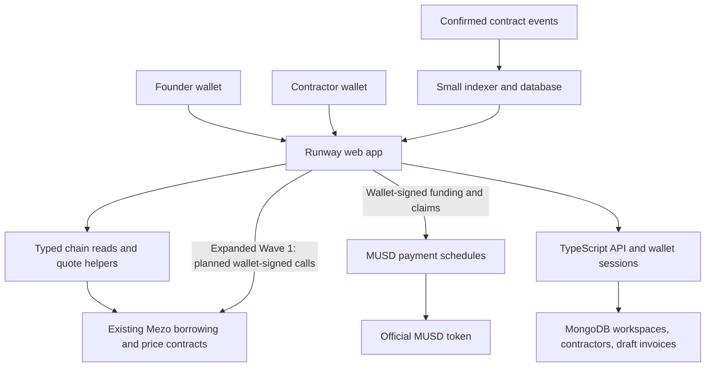

# Mezo Runway — buildathon project plan

**Pitch:** Turn Bitcoin-backed MUSD into dependable contractor payments, with a clear view of your team's cash runway and borrowing risk.

**Prepared:** October 10, 2026\
**Scope revised:** October 17, 2026. Adds a phased AI assistant, starting with sourced Runway/Mezo questions and answers. The October 13 MongoDB and expanded Wave 1 decisions remain. See [current workflow](development-workflow.md) and [AI assistant scope](ai-assistant.md).

**Recommended submission:** Track 2 (Access and Distribution); consider Track 1 when borrowing and repayment are implemented and verified.
**Deployment:** Mezo testnet first.\
**Planning assumption:** One experienced full-stack developer, with optional design help. Prioritize a complete, narrow product over feature count.

## 1. The product to build

Build a small treasury app for Bitcoin-holding studios, founders, and freelance teams that need to pay contractors in MUSD. A founder connects a wallet, sees their Mezo borrowing position, funds a payment schedule, and shares a claim link with the contractor. The contractor receives MUSD through a transparent, fully funded contract.

The dashboard answers three practical questions:

1. How much MUSD is available for new expenses?
2. Which contractor payments are already funded?
3. How would a BTC price decline affect the borrowing position funding the business?

**Core product loop:** BTC-backed borrowing → MUSD operating budget → funded contractor payments → business revenue → optional MUSD debt repayment.

Expanded Wave 1 combines the existing payment product with a MongoDB-backed workspace, contractors, draft invoices, and planned wallet-signed borrowing/repayment, cash planning, Passport, reusable helpers and pilot evidence. Wave 2 expands into payroll operations, contractor-submitted invoices, approvals and forecasting. Planned scope is not a claim of delivered functionality.

Borrowing preserves BTC exposure but introduces debt, fees, liquidation, and redemption risk. The product must show these alongside the funding flow; it must never describe borrowed funds as income or guaranteed safe spending.

## 2. Why this is my recommendation

The buildathon brief gives 60% of the score to integration and business viability. This project gives MUSD a repeated use: paying people for work. Its relationship to Mezo Borrow is easy to explain and demonstrate.

| Candidate | Strength | Main concern in this build window |
| --- | --- | --- |
| Leveraged yield vault | Potentially deep DeFi integration | Strategy, liquidity, and security dependencies |
| Generic token-transfer bot | Quick initial demo | Limited differentiation and integration depth |
| x402 API marketplace | Mezo already documents a payment path | Requires a compelling service and buyers beyond the payment wrapper |
| **Mezo Runway** | Clear user, repeated MUSD use, measurable onchain workflow | Must demonstrate a useful treasury workflow beyond a transfer screen |

This is a product judgment, not evidence that no competing treasury app exists. Validate demand and ecosystem overlap with the Mezo team before expanding the scope.

**Differentiator:** Show funded payment obligations and the associated Mezo borrowing position together. Existing payments are backed by deposited MUSD; future borrowing decisions are informed by loan health.

Start with one persona: a two-to-ten-person software studio with a Bitcoin treasury and contractors already willing to accept MUSD. Bank payouts, currency conversion, and payroll tax processing are outside the initial product.

## 3. Verified foundations and unresolved dependencies

The following facts were checked against official documentation during planning:

| Foundation | Implication |
| --- | --- |
| Mezo is EVM-compatible and uses BTC for gas | Solidity contracts and EVM wallets are suitable; retain BTC for transactions |
| Testnet chain ID is `31611`; HTTPS RPC is `https://rpc.test.mezo.org` | Use a single explicit testnet configuration |
| Mezo mainnet chain ID is `31612` | Keep deployments and addresses isolated by chain |
| The environment guide uses the `london` EVM target | Compile for the documented target and verify dependency compatibility |

Source: [Mezo getting started](https://mezo.org/docs/developers/getting-started/) and [environment setup](https://mezo.org/docs/developers/getting-started/configure-environment/).

Mezo exposes borrowing through `BorrowerOperations`, position management through `TroveManager`, and supporting price and hint contracts. Integrate deployed instances rather than redeploying the lending protocol. Documentation examples are a starting point; exact signatures and deployment parameters need confirmation. Source: [MUSD development guide](https://mezo.org/docs/developers/musd/).

Mezo Passport provides a wallet connection path for Bitcoin and EVM wallets. Start with one tested EVM wallet, then add Passport if compatibility is confirmed. Source: [Passport setup](https://mezo.org/docs/developers/getting-started/configure-mezo-passport/).

The docs also describe MUSD x402 payments. Treat that as a possible later distribution channel, not a dependency for recurring contractor payments. Source: [MUSD x402 overview](https://mezo.org/docs/developers/getting-started/musd-payments-x402/).

### First implementation-day verification gate

- Record official testnet addresses and deployed ABI versions for MUSD, BorrowerOperations, TroveManager, price feeds, and hint helpers; confirm bytecode exists at each address.
- Read token decimals and protocol parameters. Confirm minimum debt, reserves, fees, interest accounting, recovery-mode restrictions, and the exact collateral representation.
- Prove an MUSD transfer and a real position read before developing the dashboard.
- Prove borrowing/repayment transactions with the deployed ABI before releasing the expanded Wave 1 flow.
- Get test BTC through the [faucet](https://faucet.test.mezo.org/) and test MUSD through the [testnet app](https://testnet.mezo.org). Account for minimum borrowing requirements and faucet limits.
- Store verified chain configuration and source references in a deployment manifest. Never guess addresses or copy a mainnet address into testnet configuration.

**Fallback:** If borrowing write integration is blocked, ship the real MUSD payment contract, show verified position reads where available, and link to Mezo Borrow for funding. Clearly disclose the external step and submit primarily to Track 2.

## 4. Wave 1 scope: a complete payment product

### A. Wallet and onboarding

- Connect wallet, detect the network, and request Mezo testnet switching.
- Show separate MUSD and BTC gas balances.
- Provide an explicit testnet badge, funding instructions, and explorer links.
- Explain the difference between wallet MUSD, committed payment funds, and borrowed debt.

### B. Treasury dashboard

- Display real MUSD balances, remaining funded obligations, and claim history.
- Read the connected wallet's borrowing position and protocol price where available.
- Show debt and collateral metrics with their source block and update time.
- Offer a BTC stress slider for hypothetical price declines. Label it as a scenario, separate from live chain data.
- Display unknown/stale states instead of inventing a healthy position when reads fail.

### C. Fully funded recurring payment schedules

- Create a schedule with recipient address, total MUSD, start, end, and cancellation terms.
- Approve the exact funding amount, then create and fund the schedule atomically in one contract call.
- Accrue the recipient's entitlement linearly over time; claims transfer accrued MUSD.
- Let any caller trigger a claim, but always pay the immutable recipient. This allows later automation without allowing payment redirection.
- Display a shareable recipient page with accrued amount, remaining amount, terms, and claim action.
- Let the sender cancel under the displayed terms: vested funds remain claimable by the recipient; only unvested funds return to the sender.

This is funded accrual with on-demand settlement. Funds do not automatically arrive every second, and there is no background transfer service in Wave 1.

### D. Receipts

- Record confirmed transaction hashes, amounts, schedule IDs, and timestamps.
- Provide downloadable CSV transaction history for reconciliation.
- Keep names and invoice notes offchain; onchain records use addresses and opaque references.

### Wave 1 acceptance criteria

With two independent wallets on Mezo testnet, a founder can fund a schedule with the official MUSD token, and a contractor can claim accrued MUSD. Cancellation preserves vested entitlement. Balances reconcile to contract state, receipts open in the explorer, and a browser refresh recovers the workflow.

## 5. Expanded Wave 1 and Wave 2

### Expanded Wave 1: backend and complete treasury workflow

The October 13 local implementation adds a TypeScript/Hono API, MongoDB connection pooling and indexes, wallet-message login, owner-private workspaces, contractors, draft invoices and prefilled payment forms. The user's live MongoDB connection and deployment verification remain pending. Draft invoices are planning records; opening a funding form does not mark them paid or associate a confirmed schedule.

Additional Wave 1 delivery priorities:

Deliver these in priority order:

1. **Integrated borrowing:** Quote an MUSD borrowing amount, show resulting debt and projected collateralization, simulate the transaction, and request a direct wallet-signed protocol call. Refresh actual balances before a separate payment-funding transaction.
2. **Integrated repayment:** Repay debt with available wallet MUSD through the official protocol. Show the exact debt change and receipt. Do not spend recipient-reserved funds.
3. **Better risk and cash planning:** Include current debt accounting, repayment reserves, dated obligations, and stress scenarios. Surface protocol mode changes and stale prices.
4. **Reusable integration package:** Publish typed schedule creation, claim, and reading helpers, plus a minimal example so other Mezo apps can reuse the payment primitive.
5. **Pilot evidence:** Ask three target users to complete a funding or claim workflow and document friction, completion, and intended recurring use.

6. **Mezo Passport:** Verify compatibility and integrate the additional wallet path within Wave 1. Initial backend authentication supports EOA personal wallets; smart-contract wallet verification needs separate implementation.
7. **Indexed payment reconciliation:** Persist verified chain events with block/log identifiers, replay and reorg handling, then associate confirmed schedules with contractors/invoices. Keep direct RPC access for public recipient claims and clear indexer-lag disclosure.

8. **AI assistant, Phase 1:** A wallet-free chat page answers questions about Runway and Mezo using reviewed documentation, supporting source links and relevant app navigation. Implemented locally, uncommitted and undeployed, using server-side Gemini calls and isolated bounded retrieval in the existing React/Hono stack. Follow-on Phase 2 adds read-only wallet/transaction tools; Phase 3 prepares supported app actions for explicit user review and wallet confirmation. See [phased scope and acceptance criteria](ai-assistant.md).

### Wave 2: team treasury operations

1. **Payroll runs:** Prepare multiple contractor payments, review total funding and track each confirmed result.
2. **Recurring payment plans:** Manage cadence, upcoming funding and missed-payment states; reminders do not imply automatic execution.
3. **Contractor invoice submission:** Add recipient access, review, approval and confirmed settlement reconciliation beyond owner-created drafts.
4. **Treasury forecasting:** Combine upcoming obligations, expected revenue and repayment reserves, with assumptions and BTC scenarios clearly identified.
5. **Team administration:** Wallet invitations, roles, approval policies, audit records and verified multisig support.
6. **Notifications and reporting:** Opt-in reminders, risk alerts and consolidated operational reports.

An opt-in reminder service or batch claims can follow if the core flow is stable. Any automated claimant must pay gas and can only trigger transfers to the stored recipient; its reliability and operating cost must be explicit.

**Excluded from both Waves:** Leverage loops, pooled lending, automatic collateral trading, cross-chain bridges, yield on committed payroll, fiat offramps, custom tokens, and autonomous AI-controlled transactions. The planned assistant may explain information, later perform authorized reads, and eventually prepare supported actions for explicit user confirmation; it cannot independently sign or move funds. MUSD alone meets the brief's asset requirement; there is no need to force MEZO staking into the product.

## 6. Architecture



### Suggested stack

| Layer | Choice and purpose |
| --- | --- |
| Frontend | React + TypeScript + Vite; a small client-side application |
| UI | Tailwind CSS, accessible components, responsive treasury screens |
| Chain access | viem, wagmi, TanStack Query; Passport after a compatibility spike |
| Contracts | Solidity, Foundry, compatible OpenZeppelin utilities |
| Backend | TypeScript/Hono API and MongoDB for wallet sessions, workspaces, contractors and draft invoices; event indexing planned |
| Verification | Foundry unit/fuzz/invariant tests; Playwright for critical browser flows |
| Delivery | Static frontend hosting, reproducible contract scripts, deployment manifest, CI |

Pin compatible dependency versions during implementation. The database is a cache and metadata store; chain state determines balances, ownership, and claim rights. Wave 1 can use bounded RPC event scans if backend work threatens delivery.

Suggested structure:

```text
apps/web/                 dashboard, schedule form, recipient page
contracts/src/            MUSD payment schedule contract
contracts/test/           accounting, authorization, and invariant tests
packages/mezo/            verified chain config, ABIs, reads, risk math
packages/payments/        planned reusable client helpers (expanded Wave 1)
apps/api/                 TypeScript API, MongoDB, wallet sessions, workspace records
render.yaml               Render Node API deployment; Vercel proxies /api after URL setup
services/indexer/         planned verified event synchronization
deployments/              addresses, chain IDs, ABI versions, transaction hashes
docs/                     architecture, demo, threat model, submission notes
```

### Payment contract design

Use one non-upgradeable contract with an immutable official MUSD address and independent schedules. No administrator can seize scheduled funds or alter recipients.

Proposed interface, subject to implementation review:

```solidity
createSchedule(recipient, totalAmount, start, end, referenceHash)
claim(scheduleId)
cancel(scheduleId)
claimable(scheduleId)
getSchedule(scheduleId)
```

Emit creation, claim, and cancellation events. Validate nonzero addresses and amounts, `end > start`, and future or current starts. Use safe token transfers, reentrancy protection, and checks-effects-interactions.

For an active schedule:

```text
vested(t) = floor(totalAmount * clamp(t - start, 0, end - start) / (end - start))
claimable(t) = vested(t) - alreadyClaimed
```

At cancellation, freeze vested entitlement, return the unvested amount once, and preserve the unpaid vested balance for later claims. At completion, the entire total amount must become claimable, including rounding dust. No arbitrary external calls or user-supplied token addresses.

## 7. Runway and risk calculations

Keep three separate amounts: wallet MUSD, MUSD reserved inside schedules, and borrowing debt. Escrowed MUSD is committed to recipients and cannot be reused as freely available business cash.

- **Free cash:** wallet MUSD minus any user-designated repayment reserve, floored at zero.
- **Committed coverage:** calculate each schedule's remaining funded entitlement independently from free cash.
- **Unfunded runway:** free cash divided by planned monthly expenses that are not already funded. If the expense rate is zero or missing, show a descriptive state rather than infinity.
- **Collateralization:** protocol collateral value divided by protocol-accounted debt. Normalize token and oracle decimals; use accrued debt, not just the originally borrowed principal.
- **Stress collateralization:** recompute the ratio at hypothetical BTC prices while holding other inputs fixed, clearly labeling that assumption.

Do not hardcode a liquidation threshold from a tutorial. Read current parameters and account for protocol mode; a simple indicative liquidation price cannot represent all liquidation conditions. User-selected warning thresholds are planning preferences, not protocol guarantees.

Check oracle timestamps, positive prices, and decimal scaling; disable fresh borrowing quotes when inputs are invalid. Mezo documents oracle freshness and sanity checks in its [oracle guide](https://mezo.org/docs/developers/architecture/oracles/read-oracle/). Loan alerts do not guarantee protection against liquidation and do not revoke a recipient's funded entitlement.

## 8. Delivery schedule

Dates below come from [the supplied buildathon brief](Mezo_Buildathon_MUSD_MEZO.md). The public AKINDO page did not expose detailed dates to the text browser, so verify the platform countdown and deadline timezone during registration. Do not assume its `15:00` deadline uses Sri Lanka time.

| Dates | Deliverable |
| --- | --- |
| Oct 10–15 | Register, join Discord, attend Oct 13 workshop, validate persona, review docs and sketches; confirm what pre-event work is allowed |
| Oct 16 | Scaffold app and contracts; complete address, ABI, faucet, transfer, and position-read verification gate |
| Oct 17–19 | Implement funded schedules and meaningful accounting/security tests |
| Oct 20–21 | Ship founder funding and contractor claim pages with real chain data |
| Oct 22–23 | Add borrowing-position read, scenario panel, and receipts |
| Oct 24 | Complete two-wallet testnet flow; address failures and mobile usability |
| Oct 25 | Freeze Wave 1, record demo, prepare submission and deployed links |
| Oct 26 | Submit before the verified deadline with time for platform problems |
| Oct 27–Nov 1 | Collect judging feedback, interview target users, prioritize fixes |
| Nov 2–5 | Implement and verify direct borrowing and repayment flows |
| Nov 6–9 | Improve risk accounting, receipts, and reusable payment helpers |
| Nov 10–12 | Pilot walkthroughs, failure recovery, regression checks |
| Nov 13–14 | Freeze Wave 2, record updated demo, write explicit Wave 1-to-2 changelog |
| Nov 15 | Submit before the verified Wave 2 deadline |
| Nov 23 | Final online demo if selected |

If behind schedule, cut the indexer, reminders, and export polish first. Preserve real MUSD integration, correct payment accounting, recipient claims, and clear submission evidence. Ask organizers whether judging-period improvements count toward Wave 2 and record their guidance.

## 9. Verification and release gates

### Contract checks

- Funding fails atomically when allowance or balance is insufficient.
- Claims before the start, at boundaries, after completion, and after cancellation are correct.
- Repeated claims or cancellations cannot duplicate payouts or refunds.
- Only the sender can cancel; third-party claims always pay the recipient.
- Fuzz amount, time, claim order, and cancellation order.
- Assert per schedule: `claimed + refunded + remaining obligations = original funding`.
- Assert globally: contract MUSD balance covers all outstanding obligations across overlapping schedules.
- Verify malformed inputs, rounding, reentrancy attempts, and unsupported token behavior assumptions.

### Product and protocol checks

- Perform real testnet funding and claiming with the official token, not only a mock ERC-20.
- Test rejected signatures, wrong networks, low BTC gas, reverted transactions, RPC failures, and stale data.
- Keep pending transactions distinct from confirmed receipts; recover after refresh.
- In Wave 2, compare quoted and actual debt changes, test minimum debt and insufficient repayment cases, and verify the wallet retains ownership of its position.
- Keep hypothetical scenarios visually separate from live balances and prices.

The hackathon release is testnet software. A production release needs independent security review, operational monitoring, and a limited pilot. Mezo's audit and mainnet requirements for Market promotion are separate from the supplied brief's testnet submission eligibility. Source: [dApp requirements](https://mezo.org/docs/developers/getting-started/dapp-requirements/).

## 10. Demo and judging strategy

**Three-minute story:** A small studio holds BTC but needs to pay a contractor without selling that BTC outright.

1. Show a real funded wallet and its borrowing position; explain MUSD and the debt obligation.
2. Create a short demonstration schedule with actual testnet MUSD. Mark its accelerated duration as a demo convenience.
3. Open the contractor link in a second wallet and claim an accrued payment.
4. Show the MUSD balance change and confirmed explorer receipt.
5. Show a BTC stress scenario and distinguish free cash from funded obligations.
6. For Wave 2, demonstrate an actual borrowing or repayment transaction and its effect on the dashboard.

Prepare testnet funds before recording. Use sample payment amounts that satisfy deployed protocol constraints; a small schedule can be funded from an existing larger borrowing position.

| Judging criterion from brief | Evidence to provide |
| --- | --- |
| Integration — 30% | Official MUSD settlement, live position reads, Wave 2 protocol write receipts |
| Product/business — 30% | Specific studio persona, real user feedback, repeat payment workflow |
| Technical — 20% | Verified deployment, accounting invariants, reusable interface, reproducible setup |
| UX — 10% | Understandable cash categories, clear signing steps, simple contractor page |
| Materials — 10% | Focused demo, architecture, transparent limitations, Wave 2 changelog |

## 11. Business hypothesis and continuation

Hypothesis: small Bitcoin-holding teams will pay for reliable payment operations and debt-aware cash planning. Validate willingness to pay before adding complex financial features.

- Start with free testnet pilots; aim for three studio walkthroughs and at least two successful independent recipient claims.
- Measure funded schedules, confirmed claims, repeat use, MUSD payment volume, and support issues. Clearly separate team-generated demonstration activity from outside users.
- Test a monthly software subscription for receipts, accounting exports, team controls, and reminders. Keep the basic payment contract open and avoid a new token.
- Seek introductions through Mezo's developer community; listing or endorsement requires a separate application and is not assumed.
- Keep infrastructure modest: static hosting plus an optional worker/database. Budget separately for security review before handling production funds.

Post-buildathon milestones:

1. **By Dec 15, 2026:** complete five user interviews, prioritize feedback, and publish security review scope and revised design.
2. **By Jan 31, 2027:** complete independent review and fixes; launch a capped mainnet pilot only if release gates and funding permit.
3. **By Mar 31, 2027:** target three repeat-use teams, measure retained payment volume, and test paid accounting features. These are targets, not promised traction.

## 12. Submission checklist

- [ ] AKINDO registration, required Discord participation, and eligibility confirmed.
- [ ] Project name, one-sentence pitch, target user, and problem/solution.
- [ ] Primary track, chain, testnet status, and precise MUSD integration description.
- [ ] Hosted working app, public source, setup instructions, and compatible dependencies.
- [ ] Contract addresses, deployment manifest, explorer links, and example receipts.
- [ ] Architecture, threat model, test evidence, and known limitations.
- [ ] Short demo, screenshots, team members/roles/social links, and future milestones.
- [ ] Reused open-source code credited with license obligations checked; the MUSD repository lists GPL-3.0, so review licensing before copying implementation code ([repository](https://github.com/mezo-org/musd)).
- [ ] Explicit Wave 2 progress compared with the submitted Wave 1 version.
- [ ] Prize distribution and KYB requirements reviewed from the supplied brief and official terms.

**First build task on October 16:** demonstrate one real MUSD transfer and one correct Mezo position read, record the verified configuration, then implement the funded payment schedule contract.
